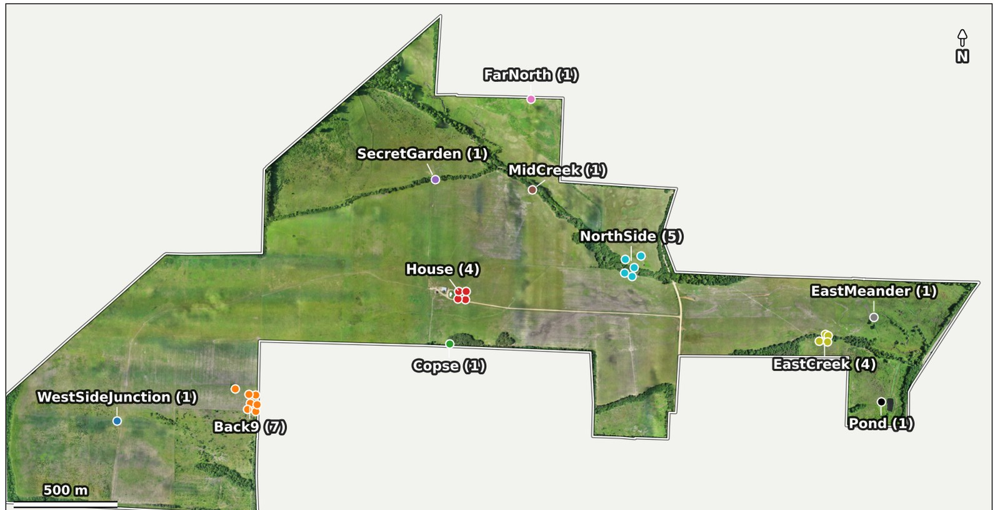
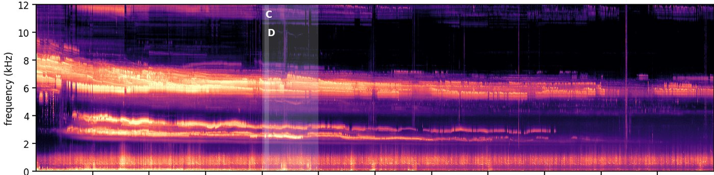

# Carbon Ranch

**Returning 400 hectares of Arkansas pasture to native forest, and listening to what comes back.**

*The ranch from the air in May 2024, with the recorder stations marked. Open former pasture, wooded creeks, ponds,
and a treeline against a commercial pine plantation.*

Carbon Ranch is a 400-hectare property in Hempstead County, southwestern Arkansas, that was grazed until 2022. It is
now the site of a long-term experiment, with Patrick O. Brown of Stanford University and the Impossible Foundation, on
how land that has come out of animal agriculture can be returned to native forest at scale, and on what returns with
the forest. The question we care about most is biodiversity, and the way we have chosen to measure it is to listen:
continuously, everywhere on the property, for years.

## The instruments

Since May 2023 autonomous recorders have run around the clock at stations spread across the ranch, 45 recorders in
all over the years and 30 running today at twelve stations, in creek-side woodland, on the pine-plantation edge, by
ponds and in the open. Four stations carry several recorders a few tens of meters apart so that calls can be
localized. Recorders stand on stools a meter off the ground, and since 2026 also on 7 m poles. The archive passed
400,000 recorder-hours in late 2025 and grows by about 700 hours a day. Five weather stations, installed in September
2026, measure air temperature, humidity, wind and rain beside the recorders; before that we relied on NOAA's HRRR
model. Drone flights give an orthomosaic of the whole property.

The sound is the data. Everything else here is about turning it into inventories that can be compared across
seasons, years and places without a person listening.

## Two tools, as examples

<table>
<tr>
<td width="50%" valign="top">

### Cardinal: where is the bird?

Cardinal localizes bird vocalizations in three dimensions from small arrays of recorders. It catalogs every recording,
detects species with [BirdNET](https://github.com/kahst/BirdNET-Analyzer), cross-checks detections across recorders,
and fits each call's position and the local speed of sound from time differences of arrival. A year at one station
puts the birds on the trees, the buildings and the fence line, not in the open field.

- Code: [carbonranch/cardinal](https://github.com/carbonranch/cardinal) (MIT), with an end-to-end demo.
- Paper: Eisen, M. B., Brown, P. O. & Matias, A. S. (2026). Automated localization of calling birds with small
  passive acoustic arrays in complex soundscapes. *bioRxiv*.

</td>
<td width="50%" valign="top">

### BROOKS: who is singing, and when?

BROOKS finds every rhythmically repeating song in the recordings without reference recordings or training data,
follows each singer through the night as its pitch and rate change with temperature, and assembles a year of singers
into call types. One year at this site gave about a million singers and 45 types, with their seasons, habitats and
temperature responses. It is named for Margarette Brooks, who first timed a cricket against a thermometer in 1881.

- Code and data: [carbonranch/brooks](https://github.com/carbonranch/brooks) (MIT; data CC BY 4.0).
- Paper: Eisen, M. B. (2026). A million orthopteran singers from a year of continuously operating field recorders,
  detected, tracked and organized by song. *bioRxiv*, in preparation.

</td>
</tr>
</table>

<table>
<tr>
<td width="50%" valign="top">

<em>One station: recorders around the farmhouse, tens of meters apart.</em>
</td>
<td width="50%" valign="top">

<em>One night at that station: bands of insect song falling in pitch as the night cools.</em>
</td>
</tr>
</table>

## What is here

- [carbonranch/carbonranch](https://github.com/carbonranch/carbonranch): the project itself. The site, the stations and
  recorder deployments, the weather stations, the imagery, the data archive and how to get at it, the papers, and
  an index of everything else.
- [carbonranch/cardinal](https://github.com/carbonranch/cardinal) and [carbonranch/brooks](https://github.com/carbonranch/brooks):
  the two analysis packages above, each usable on other people's recorder arrays.

Both packages are plain Python with a demo on real data. Issues and pull requests are welcome.

## People

Michael Eisen (University of California, Berkeley; Howard Hughes Medical Institute) and Patrick O. Brown (Stanford
University), with Ana Sanz Matias, Nadya Ali, and Cody and Katlin Lockhart, who keep the ranch and its recorders
running. Contact: mbeisen@berkeley.edu.
